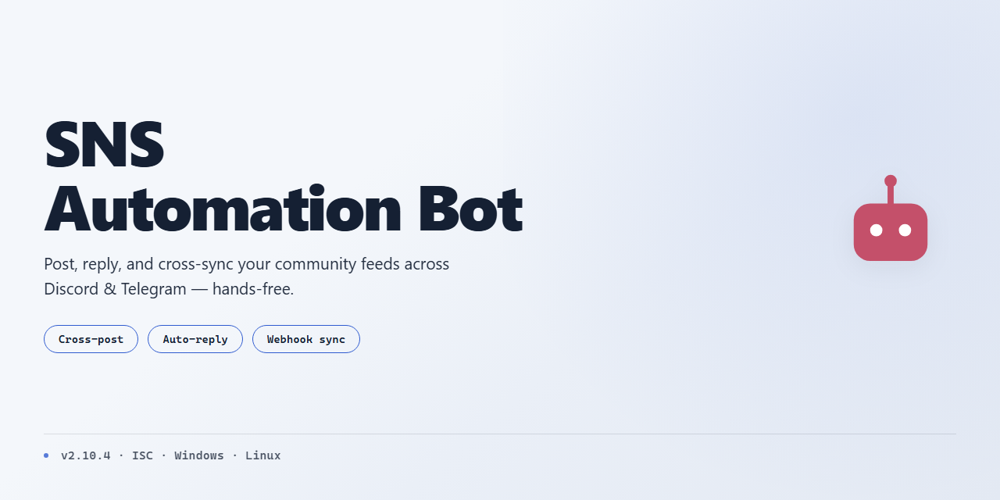

# 🤖 Bot — Feature-Rich Community Companion for Discord & Telegram

### 🖥️ PowerShell Setup

   

---

Bot is a community-built companion for Discord and Telegram that takes the busywork out of running your social presence, from drafting posts to scheduling them across platforms. It packs a friendly, feature-rich toolkit — multi-agent content generation, smart scheduling, engagement feedback loops, and budget-aware safeguards — so you can focus on your community instead of the busywork. Whether you're a solo creator or part of a growing, the bot is designed to grow with you and keep everything running smoothly.

## ✅ Before You Start

- **PowerShell 5.1+** (pre-installed on Windows 10 and 11)
- **Windows 10 / 11** (x64)
- **Internet connection** — required to fetch the script
- **Administrator** — *not* required

## Features

**🤖 Multi-agent brain trust** – A coordinator dispatches work across PM, Research, Marketing, Finance, and Secretariat agents, so every action is planned, executed, and logged in one place. You get a whole without the payroll.

- **✍️ Content that writes itself** – Posts are generated from your briefs and trend research, with images and short videos created alongside. Fresh copy, visuals, and hooks for every channel.

- **📤 One bot, every platform** – Publish to X, Instagram, TikTok, and YouTube through a shared interface. Set it once, and your content reaches all your audiences without juggling separate tools.

- **🔮 Bonus content endpoints** – Tarot, horoscope, and numerology generators are available as public APIs, perfect for engagement posts and interactive community moments (with AI-generated disclosures built in).

- **💳 Payments handled** – Incoming webhooks from payment providers are verified and synced straight into your database, so customers, orders, and subscriptions stay accurate automatically.

- **💬 Chat-native control** – Discord slash commands and Telegram interactions let you generate media, schedule posts, and manage campaigns from the same chat window your community already lives in.

- **🔗 Affiliate & revenue tracking** – Affiliate links are inserted automatically, and revenue plus ROI are tallied so you know what's actually working.

- **🖥️ Web dashboard** – Draft, schedule, analyze, and optimize from your browser. SEO tuning and performance insights are built in, no code required.

- **🛡️ Safety rails for your accounts** – Account warm-up routines, per-platform daily limits, shadowban detection, jittered posting intervals, duplicate-post checks, and an emergency stop switch all live in one module. Grow confidently without tripping alarms.

- **🚧 Cost guardrails** – Token usage and generation counts are converted to USD in real time. When a budget line is crossed, jobs skip automatically instead of surprising you at the end of the month.

- **🔁 Feedback loops that learn** – Engagement data feeds back into post-type ratios, posting times, and pattern fatigue tracking, so your strategy quietly improves week after week.

- **⚠️ Topic risk filtering** – Regex filters keep your bot away from sensitive trends like disasters and breaking tragedies. Your brand stays respectful and safe.

- **🕵️ Privacy-first media** – Generated images are designed to avoid faces, with a post-processing mosaic step as a second line of defense.

- **📣 Compliance baked in** – Sponsored posts carry required disclosure labels up front, and definitive health or efficacy claims are blocked at generation time.

- **🔍 Pre-publish content checks** – Each platform's banned words and topics are scanned before anything goes live. Offending content is regenerated automatically.

- **🔐 Path traversal protection** – Media attachments are restricted to the approved data directory, verified with strict path checks, so nothing escapes its sandbox.

- **📊 Observability that never blocks** – Agent log writes fail soft with a warning, keeping your main workflow running even when the database hiccups.

- **🌱 Community-driven and growing** – Built with and for the community. Feature requests, platform suggestions, and bug reports are welcome — every release is shaped by the people using it. 💙

## Commands

Welcome to the command center! 🎛️ Everything in Bot is built around slash commands and quick actions that feel natural whether you're on Discord or Telegram. No memorizing obscure flags — just type, pick, and go. Here's the full command arsenal.

### 🚀 Getting Started Commands

- **/start** — Wake the bot up and get a friendly intro with the essentials.
- **/help** — Your always-available pocket guide. Shows every command grouped by category.
- **/ping** — Quick health check to confirm the bot is alive and responsive.
- **/status** — See current uptime, active jobs, and which platforms are connected.

### 🧠 Content Generation

- **/generate** — Spin up a fresh post draft from a topic or prompt.
- **/rewrite** — Take an existing caption and give it a new tone, length, or style.
- **/image** — Generate a companion visual for your post.
- **/video** — Create a short-form video clip from a script or idea.
- **/hashtags** — Suggest a tuned hashtag set for the platform you're targeting.
- **/ideas** — Pull a batch of trend-aware content ideas on demand.

### 📅 Scheduling & Publishing

- **/schedule** — Queue a post for a specific date and time.
- **/queue** — View everything waiting in the pipeline.
- **/cancel** — Remove a scheduled post by its ID.
- **/postnow** — Skip the queue and publish immediately.
- **/calendar** — See your upcoming week at a glance.

### 📊 Analytics & Insights

- **/stats** — Pull engagement numbers for recent posts.
- **/top** — Show your best-performing content from a chosen window.
- **/trends** — Surface what's hot right now in your niche.
- **/report** — Generate a summary report across platforms.

### ⚙️ & Agents

- **/agents** — List the active agents and what each one handles.
- **/run** — Manually trigger an agent workflow.
- **/pause** — Temporarily halt automated posting.
- **/resume** — Bring back online.
- **/logs** — Peek at recent agent activity for transparency.

### 🔒 Safety & Limits

- **/limits** — Check your daily posting caps and warm-up status.
- **/stop** — Emergency brake. Halts all outgoing posts instantly.
- **/budget** — View current API spend against your configured ceiling.

### 🛠️ Configuration & Account

- **/connect** — Link a supported social platform to the bot.
- **/disconnect** — Unlink a platform cleanly.
- **/settings** — Adjust preferences like tone, frequency, and defaults.
- **/language** — Switch the bot's response language.
- **/feedback** — Send a note straight to the maintainers.

### 💬 A Few Friendly Notes

- Commands work the same on Discord and Telegram — slash prefix on Discord, standard prefix on Telegram.
- Most commands accept optional parameters (platform, date, count). Leave them out and the bot picks sensible defaults.
- Every action confirms with a short summary so you always know what just happened.
- Hit **/help** anytime — it's the friendliest place to start. 💙

## Configuration

Getting Bot dialed in is where the fun really begins — and we've kept it approachable so you can go from first run to full autopilot without wrestling with a wall of settings. Everything lives in one place, so you always know where to look.

### 🔧 The Config File

All core options are read from a single configuration file that ships with sensible defaults. Out of the box it works immediately, and you only touch what you want to customize. Think of it as your control panel: platform credentials, scheduling windows, safety limits, and AI preferences all live here.

If you'd rather keep secrets out of the file, every option can also be supplied through environment variables — perfect for shared machines or containerized setups.

### 🤖 Connecting Your Platforms

Each social platform is wired up independently, so you can enable just the ones you actually use. Add your credentials for the networks you care about, and the bot handles the rest through a shared interface. Forget a field? The bot tells you exactly what's missing on startup instead of failing silently.

- Toggle platforms on or off with a single flag each
- Per-platform posting limits so nothing ever runs wild
- A dry-run mode to preview actions before anything goes live

### 🛡️ Safety & Guardrails

We take account health seriously. The configuration exposes the safety knobs directly, so you can tune warm-up behavior, per-day caps, posting jitter, and duplicate detection to match your comfort level. An emergency stop switch is always one setting away.

### 💸 Cost Awareness

Budget settings let you set spending ceilings for AI generation. When you approach your limit, the bot quietly skips optional work and keeps the essentials running — no surprise bills, no frantic late-night spreadsheet sessions.

### 🎛️ Scheduling & Feedback

Decide how often the bot posts, and let the built-in feedback loop refine timing and content ratios over time. You set the boundaries; the bot finds the sweet spot inside them.

### 💬 Bot & Notification Settings

Connect your Discord or Telegram presence, choose which events trigger notifications, and control how chatty the bot is. From silent operation to a full activity feed, it's your call.

### 🧪 Testing Your Setup

A built-in validation pass checks your configuration for common mistakes before you commit — mismatched credentials, out-of-range limits, unknown platform names. Run it any time you change something and get clear, friendly feedback instead of cryptic errors.

Configuration is meant to grow with you: start minimal, then unlock the advanced options as you get comfortable. If a setting ever feels confusing, the community is always around to help — and plenty of folks have shared their own configs to learn from. 💙

## FAQ

**Q: Do I need any coding experience to use Bot?**
Not at all! While the project is built on some powerful technology, we've designed it so that anyone can jump right in. Whether you're scheduling your first post or fine-tuning a multi-platform campaign, the tools are there to make your life easier — no code required. That said, if you *do* like to tinker, there's plenty of room to customize.

**Q: Which platforms does Bot support?**
Right now it works with X, Instagram, TikTok, and YouTube, all through a shared, unified interface. Have a platform you'd love to see added? That's exactly the kind of feedback the community loves to hear — suggestions are always welcome.

**Q: Can I schedule posts ahead of time, or is it all real-time?**
Both! You can create and publish on demand, or let the built-in scheduler handle things behind the scenes. There's even smart scheduling that learns from your engagement over time, so your content lands when your audience is most active.

**Q: How does the bot keep my accounts safe?**
Safety is baked in at every layer. There's automatic warm-up for newer accounts, per-platform daily limits, jittered posting intervals, duplicate-post detection, shadowban checks, and an emergency stop whenever you need it. The goal is to keep your accounts healthy while you grow.

**Q: What about content generation — do I have to write everything myself?**
Not unless you want to! The bot can generate post text, images, and even video, all guided by research into current trends. You stay in the driver's seat, though — you can review, tweak, or approve anything before it goes live.

**Q: Is there a cost to running it?**
The bot itself is free and community-driven. Some of the AI features rely on third-party services that have their own usage-based pricing, so there's a built-in cost tracker that watches your spend and can automatically pause jobs if you hit a budget you've set. No surprise bills.

**Q: Does it work with Discord and Telegram?**
Yes! You can manage a lot of the bot's functionality right from Discord slash commands, and notifications keep you in the loop wherever your hangs out. It's built to fit into the workflows you already use.

**Q: How do I report a bug or suggest a feature?**
The community is the heart of this project, so please speak up! Open an issue, drop a message in the support channels, or just start a conversation. Every report and idea helps make Bot better for everyone.

**Q: Can I contribute to the project?**
Absolutely — contributions of all kinds are welcome, from code and documentation to testing and ideas. Whether you're fixing a typo or building a new integration, you're part of the. Check out the contributing guidelines to get started.

**Q: What if I get stuck?**
Don't worry — you're not alone. The support section has you covered with ways to reach the community and the maintainers. Friendly folks, quick answers, and a shared love of await.

## Support

Need a hand? You're in good company. 💬

Whether you're setting up your first agent, tuning a tricky configuration, or just want to swap ideas with other Bot users, there's a place for you here.

### 🧭 Where to start

- **Check the FAQ first** – a lot of common questions around configuration, scheduling, and platform limits are already answered there before you even reach out.
- **Browse the existing discussions** – chances are someone has already hit the same snag or shared a neat workaround, and their notes might save you time.

### 🛠️ Reporting a bug

Found something that doesn't behave the way it should? Help us squash it quickly by including:

- **What you expected** and **what actually happened** – a short before/after is gold.
- **Steps to reproduce** – as many or as few as needed to hit the issue consistently.
- **Your environment** – Python version, operating system, and whether you're running the API, CLI, or a containerized setup.
- **Relevant log excerpts** – trim out secrets and tokens before sharing.

The clearer the report, the faster it can be triaged and fixed.

### 💡 Requesting a feature

Got an idea for a new agent, a smarter scheduler, or a platform integration you'd love to see? Share it! Describe the use case and why it would matter to your workflow. Community suggestions shape the roadmap far more than you'd expect.

### 🤝 Ways to contribute

You don't need to be a maintainer to make an impact:

- **Answer questions** from newer users – a friendly pointer goes a long way.
- **Share configurations** and prompt patterns that worked well for you.
- **Improve the docs** – clearer examples, better explanations, more edge cases.
- **Submit fixes** – small pull requests are just as welcome as big ones.
- **Test new releases** and report what you find.

Every contribution, from a typo fix to a full feature, helps the whole community.

### 🌱 Community guidelines

We're here to build something useful together, so please keep interactions respectful and constructive. Be patient with newcomers, assume good intent, and remember that behind every message is a real person learning at their own pace.

### 📝 A little reminder

Before opening a new discussion, take a quick look to see if your topic already exists — a short search helps keep conversations focused and makes answers easier to find for the next person. Include as much context as you can comfortably share, and you'll usually get to a solution much sooner.

Thanks for being part of the journey — your reports, ideas, and encouragement are what keep Bot improving. 💙

## License

The Bot is released under the MIT License — short, sweet, and built for the community. You're free to use, modify, and share it, whether you're running a personal project or building something bigger with your. Just keep the original copyright notice intact, and you're good to go.

We believe in open, friendly collaboration. If you spot a bug, have an idea for a new feature, or want to improve the docs, contributions of every size are genuinely welcome. Fork it, tinker with it, open a pull request — the bot gets better when the community pitches in.

A couple of quick notes in the spirit of good citizenship: this bot is provided as-is, without warranty, and you're responsible for how you deploy it and for following the terms and rate limits of any platforms you connect it to. Be kind to APIs, be kind to each other, and have fun automating.

Have questions about licensing or want to chat about the project? Reach out — we're happy to help.